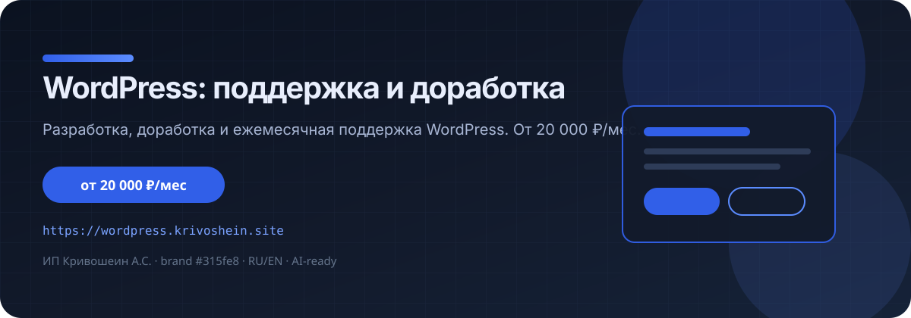

<div align="center">



**[https://wordpress.krivoshein.site](https://wordpress.krivoshein.site)** · product landing by [ИП Кривошеин А.С.](https://krivoshein.site)

[](https://wordpress.krivoshein.site)
[](https://wordpress.krivoshein.site/llms.txt)
[](https://krivoshein.site)

</div>

---

## Что это

Разработка, доработка и ежемесячная поддержка WordPress. От 20 000 ₽/мес.

Статический HTML/CSS/JS лендинг (не WordPress). Подходит для GitHub Pages, nginx или любого static host.

| | |
|--|--|
| **Сайт** | https://wordpress.krivoshein.site |
| **Цена (ориентир)** | от 20 000 ₽/мес |
| **Языки** | RU (default) · EN (toggle) |
| **Темы** | light / dark |
| **AI discovery** | `llms.txt`, `agents.md`, JSON-LD, OpenAPI, agent.json |

## Стек

- HTML5 + CSS (krv-bundle / theme / rwd) + vanilla JS
- Brand tokens с [krivoshein.site](https://krivoshein.site): `#315fe8` / `#244ac2` / `#172133`
- i18n: `assets/i18n-en.json` + TreeWalker
- SEO: canonical, OG, sitemap, robots
- AI: `llms.txt`, `llms-full.txt`, `ai.txt`, `.well-known/agent.json`

## Структура

```
.
├── index.html          # главная
├── privacy.html
├── 404.html
├── assets/             # CSS, JS, fonts, proof, i18n
├── assets/readme/      # README hero SVG
├── llms.txt            # AI summary
├── agents.md
├── robots.txt
├── sitemap.xml
└── .well-known/        # agent.json, security.txt
```

## Локальный просмотр

```bash
python3 -m http.server 8080 --directory .
# http://127.0.0.1:8080/
```

Query helpers:

```text
/?theme=dark
/?theme=light
```

Language: кнопки **RU | EN** в шапке (localStorage).

## GitHub Pages (опционально)

1. Settings → Pages → Deploy from branch `main` (root).
2. Custom domain: hostname из URL + DNS.
3. Enforce HTTPS.

Сейчас репозиторий — source of truth; production может оставаться на nginx.

## Контакты

- Telegram: [t.me/DrSlon](https://t.me/DrSlon)
- MAX: [krivoshein.site/max](https://krivoshein.site/max)
- Хаб: [krivoshein.site/contacts](https://krivoshein.site/contacts/)
- Email: aleksey@krivoshein.site

## Лицензия

© ИП Кривошеин А.С. Все права защищены, если не указано иное.  
Контент: `ai-train=no` — не для обучения моделей без согласия.

---

<div align="center">

[Live site](https://wordpress.krivoshein.site) · [llms.txt](https://wordpress.krivoshein.site/llms.txt) · [krivoshein.site](https://krivoshein.site)

</div>
